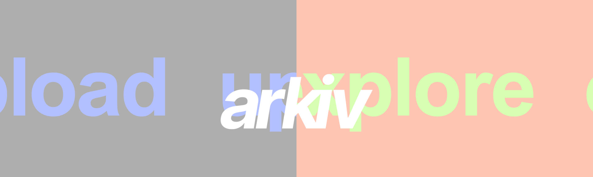

<b>brand book</b>

---

arkiv is a web app for pinning photos to a 3D globe. This brand book covers the v2 interface: colour, type, shape, layout, motion and the components used on the landing, explore and upload pages. Values come from `client/src/styles/tokens.css`, which the stylesheets and the globe both read.

## token names

The names below match the CSS custom properties in `client/src/styles/tokens.css`. `error` and `glacier` are set directly in `UploadForm.css` and `client/src/styles/mapTheme.js`. Spacing and size values are set in each component's CSS.

| name in this book | css variable | value |
| --- | --- | --- |
| `brand-lime` | `--color-primary` | #D6FFB2 |
| `brand-peach` | `--color-secondary-peach` | #FFC5B3 |
| `brand-periwinkle` | `--color-secondary-periwinkle` | #B3C0FF |
| `accent-text` | `--color-accent-text` | periwinkle |
| `marker` | `--color-marker` | peach |
| `connection` | `--color-connection` | periwinkle |
| `bg` | `--color-bg` | #FAFAFA |
| `surface` | `--color-surface` | #FFFFFF |
| `gray` | `--color-gray` | #AEAEAE |
| `gray-light` | `--color-gray-light` | #BDBDBD |
| `divider` | `--color-divider` | #D6D6D6 |
| `text` | `--color-text` | #5A5959 |
| `error` | (UploadForm.css) | #C2410C |
| `glacier` | (mapTheme.js) | #EDEDED |
| `radius-card`, `radius-box`, `radius-pill` | `--radius-card`, `--radius-box`, `--radius-pill` | 0 |
| `space-edge` | (component CSS) | 16px |
| `space-dot-grid` | (component CSS) | 120px |
| `tap-target` | (component CSS) | 44px |
| `shadow-popup` | (InfoPanel.css) | 0 12px 40px rgba(0, 0, 0, 0.08) |

## rules

- Use `brand-lime`, `brand-peach` and `brand-periwinkle` for fixed roles only: land, photos, and connections or actions.
- Views fit the screen without scrolling, on desktop and phone. The only exception is a long caption in the full-screen photo view.
- All interface text is lowercase ABC Areal. Photo titles are lowercased with `text-transform`.

## writing

- Lowercase for page names, buttons, labels, errors and titles.
- Labels and messages name the action: "add a title", "pick a date", "drop a pin on the globe".
- Error messages say which step failed: "the photo uploaded but saving failed — try again".
- No exclamation marks or emoji.

## colour

| role | token | use |
| --- | --- | --- |
| land | `brand-lime` #D6FFB2 | land on the globe, accents. Not for text. |
| photo | `brand-peach` #FFC5B3 → `marker` | photo dots, hover tint (35%), invalid underline |
| connection, action | `brand-periwinkle` #B3C0FF → `accent-text`, `connection` | connection lines, links, active controls, button borders |
| page | `bg` #FAFAFA | page, globe water, photo card frame |
| surface | `surface` #FFFFFF | panels, card text box, buttons |
| secondary text | `gray` #AEAEAE | labels, card text, inactive nav, logo |
| body text | `text` #5A5959 | body copy, typed input |
| lines | `divider` #D6D6D6 | underlines, borders, dot grid |

- Coloured text uses `accent-text`, bold, 15px or larger. `brand-lime` is 1.12:1 on white and is not used for text.
- Card text, labels and tooltips use `gray` (2.22:1 on white) by choice. Typed input and body copy use `text` (6.98:1).
- Buttons on hover: `brand-peach` at 35% over `surface`. No other hover change.
- Landing page: the upload half is `gray` with `brand-periwinkle` text, and the explore half is `brand-peach` with `brand-lime` text. On hover each half swaps its two colours.
- Page background: a lime-to-periwinkle radial gradient behind every page, scaling between 0.85 and 1.15 over 10s. Disabled with reduced motion.

## type

ABC Areal (Dinamo) at 400, 400 italic, 500 and 700. ABC Areal Mono at 400 and 700 for data. The fonts are licensed from Dinamo; the terms are in `client/src/fonts/`.

- 700 for interactive text: nav, buttons, controls, labels, titles.
- 400 for reading text: card meta, captions, popup text.
- The photo card uses 15px for every line. Weight separates title from meta and caption.

## shape and layout

- All radius tokens are 0.
- Icon buttons are a white square with a 1px `brand-periwinkle` border and a + drawn from two bars. The close × is the same + rotated 45°.
- Fixed controls sit `space-edge` (16px) from the screen edge: information bottom-left, map controls bottom-right.
- Minimum tap target on phones: `tap-target` (44px).
- Only the information popup has a shadow (`shadow-popup`).

## globe

- Land, parks and land structures: `brand-lime`. Glaciers: `glacier`. Water: `bg`.
- Photo dots: `marker`, 8px radius, no outline.
- Connection lines: `connection`. Date mode joins every pair of photos from the same day. Author mode joins one person's photos in date order.
- Background: `divider` dots, 1.5px, at a `space-dot-grid` (120px) pitch.
- Place names are hidden by default and shown with the labels toggle.

## motion

- Durations: 0.2s fast, 0.25s medium, 0.5s for the landing colour change.
- The globe rotates once per 180s. It stops on press, resumes 1.2s after a zoom ends, and pauses while a dot is hovered, while a card is open and above zoom level 3.
- `prefers-reduced-motion` turns off the rotation, the landing text drift and the background gradient animation.

## icons

There is no icon set. +, × and the expand + are drawn in CSS. ‹ and › are text characters. The drop-zone image icon is the only inline SVG: `gray-light` and blurred at rest, `accent-text` and sharp on hover or drag.

## logo

`client/src/components/arkiv.svg`: lowercase italic wordmark, 275 × 100, filled `gray` (#AEAEAE). On the landing page it is applied as a CSS mask and painted white or in the half's text colour. Use the file unchanged.

## components

### square button

The icon button: a white square with a 1px `brand-periwinkle` border and a + drawn from two bars. Turned 45°, the same + is the close ×.

- Sizes: `size-plus-header` (48px) for upload in the header, `size-square-card` (30px) for close and full size on the photo card. On phones it grows to `tap-target`.
- Hover adds `brand-peach` at 35% over white.
- Focus: 2px `accent-text` outline, offset 2–3px.
- Requires an `aria-label` (upload, close, open full size).

Source: `Header.css` (.nav-plus), `Map.css` (.card-square).

### button

The outlined text button, used once per view for the main action (upload, see it, next). Same style as the square button: white fill, 1px `accent-text` border, square corners and the `button` text style (22px bold, lowercase).

- Hover adds `brand-peach` at 35%.
- While working, the label changes (uploading…, saving…) and the button pulses its opacity. It stays disabled until done.
- A second, lesser action beside it is a text link (upload another), not a second button.

Source: `UploadForm.css` (.upload-button).

### text link

An inline action or link in `accent-text`, 15px bold, lowercase. A 1px underline grows in from the left on hover or focus. External links end in ↗.

Source: `InfoPanel.css` (.info-link), `UploadForm.css` (.upload-link).

### map toggle

A plain-text toggle: an 11px square (`size-toggle`) and a word. Off is a gray outline. On fills the square and turns square and word `accent-text`. Used for recent and labels, stacked in the bottom-right corner so the squares line up.

Hover darkens an off toggle to `text`. There's no box or pill around it.

Source: `Map.css` (.map-toggle).

### connect switch

Chooses what links photos on the globe: date (photos from the same day) or author (one person's photos, in date order). It's a square track with a square knob that slides to the chosen side, and each word also selects its side. The chosen word is `accent-text`.

On phones the "connect by" label is dropped so the switch fits on one row with the information pill.

Source: `Map.css` (.connect-filter, .connect-switch).

### information pill

Opens the information popup on explore. 40px tall (`size-pill-height`) with a 1px `divider` border that turns `accent-text` when open. It sits bottom-left, `space-edge` from the edges.

The popup uses `shadow-popup`. It describes arkiv, states that uploads are public, and closes when a photo card opens.

Source: `InfoPanel.css`.

### tooltip

The hover preview on a photo dot: the title only, 15px bold lowercase in `gray`, in a white box with a 1px `divider` border. It sits 14px right of the dot and flips to the left within 290px of the right edge. It never takes pointer events.

The dot itself is `marker` at `size-marker` (8px radius), flat, with no outline.

Source: `Map.css` (.marker-tooltip).

### photo card

Opens when a dot is clicked. Contents: the photo, then a white text box with the title, one meta line and the caption, then a bottom row with the arrows and the full-size button.

- Frame: `bg` with `space-card-pad` (10px) around the photo and the text box. Flat: no shadow, `radius-card` (0).
- Text: every line is 15px `gray`. The title is bold and forced lowercase, two lines max. Meta is one line, by name · date · place. The caption shows three lines.
- The photo keeps its own aspect ratio and gives up height when the text needs room. The card never scrolls.
- Arrows (‹ ›) are plain bold `accent-text` text. The count names the set: "3 of 5 · same author".
- Desktop: up to 500px wide, right of centre, with a `connection` line to the dot. Phones: a sheet along the bottom, swipe to step.
- The consumer supplies the image URL, title, author, date, country, caption and the linked set.

The preview photo is a placeholder drawing.

Source: `Map.css` (.marker-card), `Map.js`.

### text field

An upload form field: a 14px bold `gray` label over an underlined input. Typed text is 22px bold `text` (18–22px with screen height). The placeholder is `divider`.

- Focus turns the underline `accent-text`. Invalid turns it `brand-peach`, with a 14px bold `error` message under the field.
- Errors clear as soon as the field changes.
- Messages are short and lowercase: "add a title", "pick a date", "add the author".

Source: `UploadForm.css` (.upload-field, .upload-error).

### drop zone

The photo box on the upload page: a 1px dashed `divider` border with a blurred `gray-light` image icon at rest. On hover or drag the border and icon turn `accent-text`, the icon blur is removed and a periwinkle radial gradient (22%) fills the box.

- It takes whatever height is left in the column, so the form fits without scrolling.
- "take a photo" opens the native camera on phones and a webcam window on desktop.
- It accepts images under 10 MB. Other files get "that file isn't an image".

Source: `UploadForm.css` (.upload-drop).
